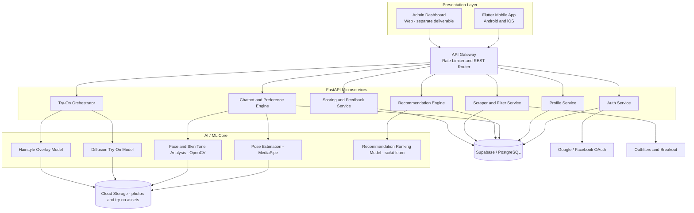
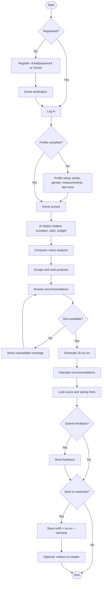

# SmartFit — Architecture

Companion to `prd.md` (what/why) and `rules.md` (constraints). This file is the how: stack, system shape, flow, and file layout.

## 1. Tech Stack

| Layer | Technology | Notes |
|---|---|---|
| Mobile frontend | Flutter / Dart | Android 8.0+ (API 26) and iOS 13.0+. Mobile only — no web build of the end-user app. |
| State management | Riverpod | No mixing with Provider/Bloc/GetX — see `rules.md`. |
| Navigation | GoRouter | Declarative routes + guards for auth/profile-complete gating. |
| HTTP client | Dio | Single client, shared interceptors for auth + error mapping. |
| Backend API | FastAPI (Python) | Serves auth, profile, chatbot, CV, recommendation, try-on, hairstyle, scoring, feedback, wardrobe endpoints. |
| Auth & DB | Supabase (PostgreSQL) | Auth (incl. OAuth), row-level security, realtime for wardrobe/session sync. |
| Storage | Supabase Storage (or AWS S3) | Private buckets, signed URLs for photos and generated try-on images. |
| AI/ML — CV | MediaPipe (pose), OpenCV (face + skin tone) | Body shape, proportions, size estimation. |
| AI/ML — Try-on | Diffusion-based image generation | See `prd.md` open question #3 on model choice. |
| AI/ML — Recommendation | scikit-learn (style vector ranking) | Behind `recommendation_service`. |
| Scraping | Python + BeautifulSoup | Targets: Outfitters, Breakout. |
| Containerization | Docker → Kubernetes (AWS EKS) | One container per microservice; stateless services. |
| Admin panel | Separate web app (stack TBD) | Not part of the Flutter codebase — see `prd.md` open question #2. |

## 2. System Architecture



This mirrors the SRDS package diagram (§5.1.1) and deployment diagram (§5.1.2) — five layers: presentation, application/auth, core services, AI/ML core, and data, each independently deployable per the maintainability requirement (§4.3.3). The service boxes here are consolidated slightly from the SRDS's package diagram (which further splits size/budget/occasion filtering into their own boxes) — that granularity is preserved in the backend folder structure below, just grouped differently for a 2-person build.

## 3. End-to-End App Flow



Matches SRDS §5.5 (state machine) and §5.6 (activity diagram / pseudocode) — build against those diagrams if this ever needs a tie-breaker.

## 4. Mobile App Architecture (Flutter, Clean Architecture)

Three layers per feature, per the maintainability requirement (§4.3.3 — "clear separation between presentation, business logic, and data layers"):

- **presentation/** — screens, widgets, Riverpod providers/notifiers. No business logic beyond UI state.
- **domain/** — entities, repository interfaces, use cases. Pure Dart — no Flutter, Supabase, or Dio imports (see `rules.md` §4).
- **data/** — repository implementations, remote/local data sources, DTOs/models with JSON mapping.

### 4.1 Folder Structure

```
smartfit_app/
├── android/
├── ios/
├── lib/
│   ├── main.dart
│   ├── app.dart                          # MaterialApp.router + theme + provider scope
│   ├── core/
│   │   ├── config/
│   │   │   ├── env.dart                  # --dart-define wrapper (Supabase URL/anon key, API base URL)
│   │   │   └── supabase_client.dart
│   │   ├── theme/                        # see design.md — tokens live here
│   │   │   ├── app_colors.dart
│   │   │   ├── app_typography.dart
│   │   │   ├── app_radii.dart
│   │   │   ├── app_spacing.dart
│   │   │   ├── app_theme.dart
│   │   │   └── glass_decoration.dart     # reusable glassmorphism BoxDecoration builder
│   │   ├── router/
│   │   │   ├── app_router.dart           # GoRouter config + route names
│   │   │   └── route_guards.dart         # auth guard, profile-complete guard
│   │   ├── network/
│   │   │   ├── dio_client.dart
│   │   │   ├── api_endpoints.dart
│   │   │   └── interceptors/
│   │   │       ├── auth_interceptor.dart
│   │   │       └── error_interceptor.dart
│   │   ├── error/
│   │   │   ├── failure.dart              # sealed Failure classes
│   │   │   └── exceptions.dart
│   │   ├── widgets/                      # shared "dumb" widgets
│   │   │   ├── smartfit_button.dart
│   │   │   ├── smartfit_text_field.dart
│   │   │   ├── ambient_orb_background.dart
│   │   │   ├── glass_card.dart
│   │   │   ├── match_badge.dart
│   │   │   └── loading_states.dart       # skeleton / error / empty widgets
│   │   └── utils/
│   │       ├── validators.dart
│   │       └── extensions.dart
│   ├── features/
│   │   ├── auth/                         # SF-UC-01, SF-UC-02
│   │   │   ├── data/
│   │   │   ├── domain/
│   │   │   └── presentation/
│   │   │       ├── screens/{welcome,signup,login,forgot_password}_screen.dart
│   │   │       └── providers/auth_provider.dart
│   │   ├── onboarding/                   # SF-UC-03, 4-step profile setup
│   │   │   └── presentation/
│   │   │       ├── screens/profile_setup_screen.dart
│   │   │       └── widgets/steps/{photo,gender,body_measurements,skin_tone}_step.dart
│   │   ├── home/
│   │   │   └── presentation/
│   │   │       ├── screens/home_screen.dart
│   │   │       └── widgets/{quick_actions,trending_carousel,for_you_list}.dart
│   │   ├── chatbot/                      # SF-UC-04
│   │   │   └── presentation/
│   │   │       ├── screens/chatbot_screen.dart
│   │   │       └── widgets/{chat_bubble,product_result_card,chat_input_bar}.dart
│   │   ├── recommendations/              # SF-UC-05
│   │   ├── try_on/                       # SF-UC-06
│   │   ├── hairstyle/                    # SF-UC-07
│   │   ├── look_score/                   # SF-UC-08, SF-UC-09
│   │   ├── wardrobe/                     # SFR-035–038
│   │   └── settings/                     # SFR-007, SFR-008
│   └── l10n/                             # future
├── test/
│   ├── features/                         # unit tests mirror lib/features structure
│   └── widget/
├── pubspec.yaml
└── analysis_options.yaml
```

Each `features/<name>` folder repeats the `data/domain/presentation` split shown for `auth/`; trimmed above for length.

### 4.2 State Management

- One `Notifier`/`AsyncNotifier` per screen-level concern (e.g. `authProvider`, `onboardingProvider`, `chatbotSessionProvider`).
- Every async provider exposes `AsyncValue<T>` — screens switch on `.when(data:, error:, loading:)`, never on ad hoc booleans.
- Repositories are injected via `Provider`, not instantiated inside notifiers — keeps data sources swappable and testable.
- Cross-feature state that outlives a single screen (current session, current user profile) lives in a small number of app-level providers under `core/`, not duplicated per feature.

### 4.3 Navigation (GoRouter)

```
/                          → Splash (auth check → redirect)
/welcome                   → WelcomeScreen
/signup                    → SignUpScreen
/login                     → LoginScreen
/forgot-password           → ForgotPasswordScreen
/onboarding                → ProfileSetupScreen        [guard: authed && !profileComplete]
/home                      → HomeScreen (shell)         [guard: authed && profileComplete]
  /home/chatbot             → ChatbotScreen
  /home/recommendations     → RecommendationsScreen
  /home/try-on/:productId   → TryOnScreen
  /home/hairstyle           → HairstyleScreen
  /home/look-score          → LookScoreScreen
  /home/wardrobe            → WardrobeScreen
  /home/settings            → SettingsScreen
```

Guards live in `route_guards.dart` and read from the auth/profile providers — no navigation logic embedded in widgets.

### 4.4 Networking

- One `Dio` instance (`dio_client.dart`), base URL from `env.dart`.
- `auth_interceptor.dart` attaches the Supabase JWT to every request and handles silent refresh on 401.
- `error_interceptor.dart` maps HTTP/network errors to the app's `Failure` types before they ever reach a provider — screens never handle raw `DioException`.

## 5. Backend Architecture (FastAPI Microservices)

Mirrors the SRDS package diagram — one container per service, independently deployable and versioned (§4.3.3).

```
smartfit_backend/
├── services/
│   ├── auth_service/            # JWT/OAuth validation, session mgmt
│   ├── profile_service/         # profile CRUD, photo upload handling
│   ├── chatbot_service/         # session + dynamic preference collection
│   ├── cv_service/              # pose estimation, face/skin-tone analysis, size estimation
│   ├── recommendation_service/  # style-vector ranking (scikit-learn)
│   ├── scraper_service/         # BeautifulSoup scrapers, scheduled jobs, per-retailer configs, size/budget/occasion filters
│   ├── tryon_service/           # diffusion model inference (GPU)
│   ├── hairstyle_service/       # hairstyle overlay generation
│   ├── scoring_service/         # look scoring + styling hints
│   └── feedback_service/
├── shared/
│   ├── schemas/                 # Pydantic models shared across services
│   ├── middleware/              # auth, RBAC, rate limiting
│   └── db/                      # Supabase client wrapper
├── docker-compose.yml           # local dev orchestration — start here
├── k8s/                         # per-service Deployment/Service/HPA manifests — production target
└── .github/workflows/ci-cd.yml
```

`docker-compose.yml` is the practical day-to-day target; full EKS/Kubernetes is worth standing up once the services themselves are stable, not on day one.

### 5.1 API Surface (representative)

```
POST   /auth/register            POST   /auth/login
POST   /auth/oauth/{provider}    POST   /auth/forgot-password

GET    /profile/me               PUT    /profile/me
POST   /profile/photo

POST   /sessions                 POST   /sessions/{id}/messages
POST   /sessions/{id}/photo

POST   /cv/analyze               GET    /cv/analyze/{id}/status

GET    /recommendations?session_id=
GET    /products/{id}/size-check

POST   /tryon/generate           GET    /tryon/{id}

GET    /hairstyles?session_id=   POST   /hairstyles/{id}/select

GET    /score?session_id=        POST   /feedback

GET    /wardrobe                 POST   /wardrobe        GET /wardrobe/{id}

# Admin — RBAC-protected, separate from the above
GET    /admin/users              PATCH  /admin/users/{id}/suspend    DELETE /admin/users/{id}
GET    /admin/products           POST   /admin/products
GET    /admin/analytics          GET    /admin/feedback
```

## 6. Data Layer

### 6.1 Schema (proposed — refine as Supabase migrations)

Maps directly to the SRDS ER diagram (§5.3): `profiles`, `sessions`, `analysis_results`, `products`, `recommendations`, `try_ons`, `hairstyles`, `look_scores`, `feedback`, `wardrobe_items`, `admins`.

```sql
profiles          (id uuid PK → auth.users, gender, height_cm, weight_kg, chest_cm,
                    waist_cm, hip_cm, skin_tone, photo_url, body_type,
                    onboarding_complete boolean, created_at)

sessions          (id uuid PK, user_id FK, occasion, style_preferences jsonb,
                    color_preferences jsonb, budget_range jsonb, photo_url, created_at)

analysis_results  (id uuid PK, session_id FK, body_shape, estimated_size,
                    pose_vector jsonb, measurements jsonb, created_at)

products          (id uuid PK, retailer, name, brand, category, price, currency,
                    sizes text[], image_url, product_url, scraped_at)

recommendations   (id uuid PK, session_id FK, product_id FK, rank_score, created_at)

try_ons           (id uuid PK, session_id FK, product_id FK, generated_image_url,
                    status text, created_at)          -- status: pending/success/unavailable/failed

hairstyles        (id uuid PK, session_id FK, name, overlay_image_url,
                    is_default boolean, created_at)

look_scores       (id uuid PK, session_id FK, outfit_score, style_score,
                    event_fitness, explain_text, created_at)

feedback          (id uuid PK, session_id FK, user_id FK, rating int,
                    comment, suggestion, created_at)

wardrobe_items    (id uuid PK, user_id FK, session_id FK, product_id FK,
                    try_on_id FK, hairstyle_id FK, saved_at)

admins            (id uuid PK → auth.users, role, created_at)
```

Every table gets row-level security enabled by default — see `rules.md` §5. `profiles` and `admins` reference `auth.users` directly rather than duplicating a `users` table, since Supabase Auth already owns identity.

### 6.2 Storage

Two private buckets, both accessed via time-limited signed URLs (never public):
- `user-photos` — profile photos, session reference photos
- `generated-assets` — try-on outputs, hairstyle overlays

## 7. External Integrations

| Integration | Used by | Notes |
|---|---|---|
| Google OAuth | Auth service | Via Supabase Auth |
| Facebook OAuth | Auth service | Required by SFR-001/004; confirm before building — see `prd.md` open question #1 |
| Outfitters, Breakout | Scraper service | Real-time or scheduled per SFR-022; see `prd.md` open question #4 on caching |
| FCM / APNs | Notification layer | Push for "recommendations ready," session completion |

## 8. Admin Panel

Explicitly a **separate web deliverable**, not part of this Flutter codebase (SRDS §2.1, §2.3.9). Treat it as its own small project once the mobile app's core flow is solid — see `phases.md` Phase 10 and `prd.md` open question #2 for scope/stack decisions.

## 9. Presentation Layer Architecture & Gen-Z Design System

### 9.1 Iridescent Glassmorphism & Animated Navigation
- **Background Layer**: Custom high-efficiency vector painter `ClothingPatternBackground` (`lib/core/widgets/clothing_pattern_background.dart`) drawing staggered fashion silhouettes (`checkroom`, `shopping_bag`, `diamond`, `straighten`, `brush_outlined`, etc.) in deep vibrant pink (`0xFFD81B60`) at 16% opacity across all 15 screens.
- **Strict Light Mode Splash**: `SplashScreen` (`lib/features/auth/screens/splash_screen.dart`) built with a pure light palette (`#FCF8F9`), delicate ambient radial glows, frosted glass cards (`alpha: 0.88`), and dark typography (`#1E1A2A`).
- **Animated Glassmorphic Navigation**: `SFBottomNavBar` with double-layered backdrop blur (`ImageFilter.blur(sigmaX: 36, sigmaY: 36)`), iridescent borders (`#FF2E93` at 22%), and dedicated `_InteractiveNavTab` and `_InteractiveCenterTab` widgets that spring-scale (`0.84` scale on touch down with `Curves.easeInOutBack`) and bounce back up smoothly when clicked.
- **Micro-Interactions**: Tactile button shrink on press (scale `0.96`), staggered entrance animations via `flutter_animate`, and glassmorphic card drop shadows (`blurRadius: 36`).

### 9.2 Luxury-Editorial Quotes System
- **Haute Couture Inspiration Card**: `_buildInspirationCard()` in `lib/features/home/screens/home_dashboard_screen.dart` with a glowing pearlescent surface, large decorative watermark quotation mark (`“`), an iridescent `DAILY STYLE INSPIRATION` gradient chip, interactive **Shuffle** button with haptics, and a sleek **Copy** button.
- **Clean Layout**: Completely removed the Gen-Z trends section, match scores, and quick search bar from the home screen for a refined, modern editorial design.

### 9.3 Notification System Synced with Settings
- **Notification State**: `NotificationNotifier` (`lib/core/providers/notification_provider.dart`) monitors user settings in `SharedPreferences` (`outfit_notifications_enabled`). When enabled, displays interactive notification feeds with unread badge updates and "Mark all read" capabilities.

### 9.4 Clear Bilingual AI Stylist & Cultural Ethnicity Validation
- **Stylist Language & Persona**: Simplified Gemini system prompt to use clear, simple everyday English mixed naturally with friendly Roman Urdu (Urdu-English/Hinglish). Removed all confusing fashion slang and runway jargon. Responses are short (2-3 sentences), polite, and easy for every user to understand without emoji clutter.
- **Cultural Ethnicity Validation**: Chatbot checks the user's profile ethnicity (e.g., Punjabi, Sindhi, Balochi, Pathan, Saraiki). If not yet specified, actively validates in clear English + Roman Urdu: *"Aapne profile mein [Ethnicity] select kiya hai. Kya aapko [Ethnicity] traditional cultural outfits dekhne hain, ya overall general styles?"*
- **Strict Cultural Filtering**: When confirmed, recommendations and scraped products are strictly filtered to that culture's traditional garments (e.g., Punjabi Kurta Pajama, Patiala Shalwar, Phulkari, Tehmat, Khussa for Punjabi).
- **Interactive UI**: Clean starter chips in simple English + Roman Urdu (`Fit check karwaen`, `Casual daily wear`, `Party ya wedding dress`, `Under 10k budget look`, `Traditional cultural suit`), and clean action pills without emojis.

### 9.5 Rounded Screen Transition Loading Bar
- **Circular Neon Progress Indicator**: `SFTransitionLoader` and `SFNavHelper` (`lib/core/widgets/sf_transition_loader.dart`) provide a high-end 2.5-second rounded loading screen with a custom neon sweep gradient (`#FF2E93` → `#6C4CE0` → `#00E5FF`), rounded stroke caps, real-time percentage counter (`0%` to `100%`), and progressive couture styling status messages.
- **Seamless Navigation**: Bottom navigation bar and home action cards navigate through `SFNavHelper.navigateWithLoader` for consistent, aesthetic transitions.

### 9.6 Loved Fit Checkbox & Feedback Learning Recommendation System
- **Interactive Checkbox**: Product cards in the AI Stylist chat carousel feature a dedicated **Love Fit** checkbox with animated gradient fill, checkmark icon, and tactile haptic feedback.
- **Feedback Learning Model**: `LovedFitsNotifier` (`lib/features/chat/providers/loved_fits_provider.dart`) captures loved fits into Hive and Supabase (`user_feedback` table). It extracts style preferences (favorite categories, brands, colors, styles) and feeds them into:
  1. The `ScraperApiService` product recommendation queries (automatically boosting loved categories and brands).
  2. The Gemini AI Stylist prompt context (`User Learned Fashion Feedback (from Loved Fits)`), ensuring subsequent recommendations learn and adapt to the user's taste.
